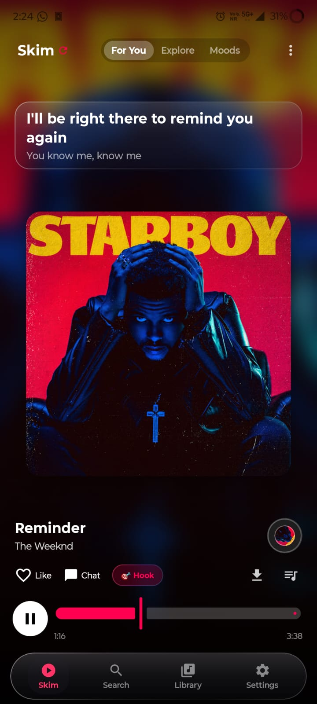
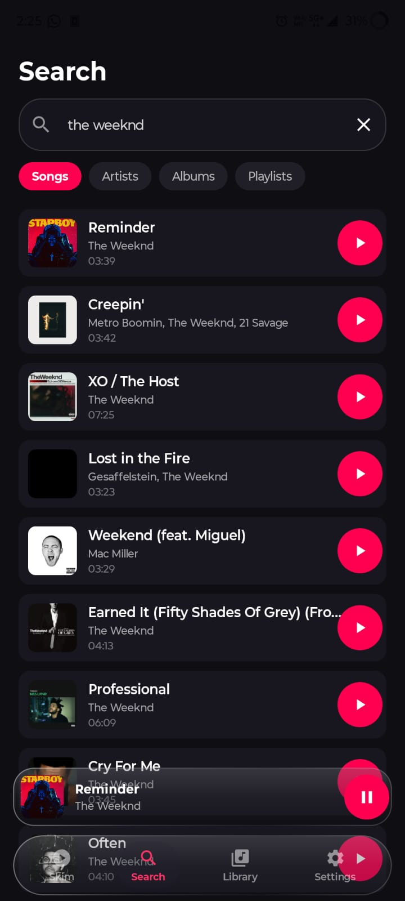
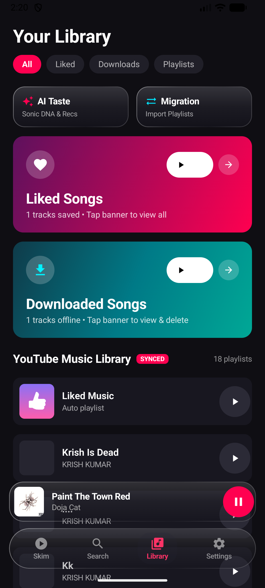
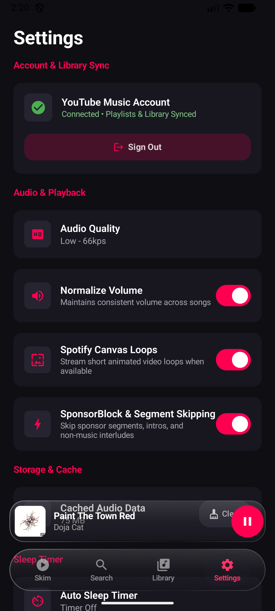
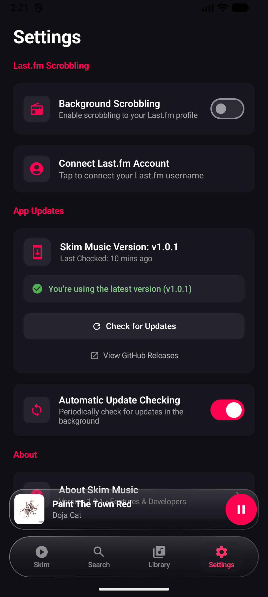

<p align="center">
  
</p>

# <p align="center">🎵 Skim Music</p>

<p align="center">
  <b>The modern, ad-free music streaming experience with Apple Liquid Glass aesthetics.</b><br/>
  Blending the addictive vertical discovery of TikTok & Resso with the endless catalog of YouTube Music.
</p>

<p align="center">
  <a href="https://github.com/Roixal/Kazatune/releases/latest">
    
  </a>
  <a href="https://github.com/Roixal/Kazatune/releases">
    
  </a>
  
  
</p>

---

## 📸 Screenshots Showcase

<p align="center">
  
  
  
  
  
</p>

<p align="center">
  <i>1. Vertical Discovery Feed &bull; 2. Instant Search &bull; 3. Personal Library &bull; 4. Audio Engine Settings &bull; 5. In-App Auto Updates</i>
</p>

---

## ⬇️ Quick Download & Install

Get the latest stable APK directly from GitHub Releases:

<p align="center">
  <a href="https://github.com/Roixal/Kazatune/releases/latest">
    
  </a>
</p>

1. Download **`SkimMusic-v1.0.1.apk`** from [GitHub Releases](https://github.com/Roixal/Kazatune/releases/latest).
2. Tap the downloaded file to install (*Allow installation from this source* if prompted).
3. Open Skim Music and enjoy endless ad-free streaming!

> [!NOTE]
> All future releases can be updated **automatically inside the app** without ever needing to manually download an APK again.

---

## 🌟 What Makes Skim Music Unique?

### 📱 1. Infinite Vertical Discovery Feed
Traditional music apps force you to search, pick albums, and manage static queues. **Skim Music flips music discovery on its head**:
- **Continuous Swipe:** Swipe up or down through an endless, curated stream of music.
- **Instant Previews:** Music buffers instantly with zero lag or buffering silence.
- **🎯 One-Tap Hook Jump:** Tap the **Hook** button to immediately jump right to the song's climax or chorus.
- **Double-Tap to Like:** Rapidly save tracks to your personal favorites with a haptic heart animation.

### 🎤 2. Word-by-Word Synced Karaoke Lyrics
- Sing along in real-time with dynamically highlighted lyrics scrolling along with the singer.
- Includes a dedicated **Timing Offset Calibrator** (`-0.5s`, `+0.5s`) for frame-perfect alignment.
- **Share Lyric Cards:** Select any lyric line to export and share a custom lyric poster directly to Instagram, WhatsApp, or Twitter.

### 💿 3. Self-Healing Playback & Spinning Vinyl Turntable
- An animated, rotating vinyl turntable disc spins in real-time in the corner of your screen.
- **Self-Healing Reload:** If network drops or an expired YouTube token causes music to pause, simply **tap the rotating vinyl disc**. It instantly purges cached buffers, fetches a fresh high-bitrate audio token, and resumes playback seamlessly without interrupting your listening session.

### 🔄 4. GitHub-Powered In-App Auto Updates
- No Google Play Store required.
- The app automatically queries GitHub Releases in the background.
- Whenever an update is published, a modern Liquid Glass update sheet appears with full release notes, download progress, and one-tap installation.

### 🧠 5. 100% Private On-Device AI Music Taste Engine
- Deep listening analysis that runs **entirely on your device's processor** with **zero data collection, no external servers, and no paid API keys**.
- Analyzes skip rates, completion percentages, replay counts, and time-of-day listening habits.
- Unlocks dynamic listener personas (e.g., *"Late-Night Melancholic Explorer"*, *"High-Energy Groove Hunter"*) alongside personalized taste evolution radar charts.

### 🔀 6. Universal Playlist Importer (Spotify, YouTube, Text)
- Switch to Skim Music in seconds without losing your songs.
- Paste any **Spotify playlist URL**, **YouTube/YouTube Music link**, or raw text tracklist (`Song - Artist`).
- Automatically resolves metadata against YouTube's lossless catalog and saves it directly into your local offline library.

### 🛡️ 7. SponsorBlock & Clean Audio Focus
- **SponsorBlock Integration:** Automatically detects and skips non-music intros, promotional sponsored shoutouts, skit dialogue, and end cards.
- **Intelligent Audio Focus:** Smoothly ducks volume during navigation/GPS announcements and automatically pauses when headphones or Bluetooth disconnects.
- **Lockscreen & Android Auto:** Full notification playback bar, seekable progress scrubber, and Android Auto dashboard integration.

### 📲 8. Android Home Screen Glance Widgets
- **Turntable Player Widget:** Interactive rotating disc widget with one-tap play, pause, and skip controls.
- **Recent Playlists Widget:** Quick access to your top playlists and downloads from your home launcher.
- **30-Day Insights Widget:** Glance at your top artist, total streaming hours, and listening variety.

---

## 🎮 Gestures & Shortcuts Quick Reference

| Gesture / Control | Action |
| :--- | :--- |
| **Swipe Up / Down** | Advance to next / previous song in the discovery feed |
| **Double Tap Card** | Like track and add to Favorites (plays heart animation) |
| **Tap Rotating Vinyl** | **Self-healing reload:** Purges stalled streams and refreshes audio tokens |
| **Tap 🎯 Hook Button** | Immediately seek to the song's chorus / peak moment |
| **Rotate to Landscape** | Opens the dual-pane tablet player with large vinyl & synced lyrics |
| **Tap 3-Dots (...)** | Opens full track details, artist page, share, and playlist controls |

---

## 🏗️ Architecture & Under the Hood

Skim Music is built from the ground up using modern Kotlin Multiplatform architecture and Jetpack Compose:

```
Skim/
├── app/                  # Main Android application & Compose UI entrypoint
├── core/
│   ├── model/            # Clean Architecture domain models (Track, Playlist, Lyrics)
│   ├── ui/               # Apple Liquid Glass design system, shaders & themes
│   ├── player/           # Media3 ExoPlayer & background MediaSessionService
│   ├── database/         # Room Database (Offline storage, Playlists, AI Stats)
│   ├── network/          # Ktor client & YouTube Music extraction engine
│   └── data/             # Repositories, SponsorBlock, Last.fm, & AI Engine
└── updater/              # Native GitHub Releases auto-update engine
```

| Component | Technology |
| :--- | :--- |
| **Language** | [Kotlin 2.0+](https://kotlinlang.org/) (Coroutines, Flow, Serialization) |
| **UI Framework** | [Jetpack Compose](https://developer.android.com/jetpack/compose) & [Material 3](https://m3.material.io/) |
| **Audio Pipeline** | [AndroidX Media3 ExoPlayer](https://developer.android.com/media/media3) + MediaSession |
| **Widgets** | [AndroidX Glance](https://developer.android.com/jetpack/compose/glance) |
| **Local Storage** | [Room Database](https://developer.android.com/training/data-storage/room) with SQLite |
| **Dependency Injection** | [Koin](https://insert-koin.io/) |
| **Networking** | [Ktor Client](https://ktor.io/) & [Coil](https://coil-kt.github.io/coil/) |
| **Telemetry** | [Aptabase](https://aptabase.com/) (100% Privacy-friendly, zero personal tracking) |

---

## 🛠️ Building from Source

### Prerequisites
- Android Studio Ladybug (2024.2+) or newer
- JDK 17 or higher
- Android SDK 34+

```bash
# 1. Clone the repository
git clone https://github.com/Roixal/Kazatune.git
cd Kazatune

# 2. Build the Debug APK
./gradlew assembleDebug

# 3. Install onto connected Android device or emulator
adb install -r app/build/outputs/apk/debug/app-debug.apk
```

---

## 👥 Developers & Contributors

<table align="center">
  <tr>
    <td align="center" width="200">
      <a href="https://github.com/krixh15">
        <br />
        <b>KRISH KUMAR</b>
      </a><br />
      <sub>Developer</sub>
    </td>
    <td align="center" width="200">
      <a href="https://github.com/Roixal">
        <br />
        <b>Roixal</b>
      </a><br />
      <sub>Developer</sub>
    </td>
  </tr>
</table>

---

## 📄 License

Distributed under the **GNU General Public License v3.0**. See the [LICENSE](LICENSE) file for more details.

<p align="center">
  Crafted with ❤️ for music enthusiasts worldwide.
</p>
