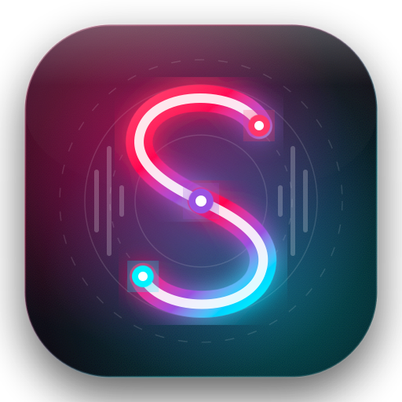

  

# 
🎵 Skim Music

  <b>The modern, ad-free music streaming experience inspired by Apple Liquid Glass.</b> 
  Blending the addictive discovery of TikTok & Resso with the endless catalog of YouTube Music.

  
  
  
  
  
  

---

## 📸 Screenshots Showcase

  
  
  
  
  

  <i>1. Vertical Discovery Feed &bull; 2. Instant Search &bull; 3. Personal Library &bull; 4. Audio Engine Settings &bull; 5. In-App Auto Updates</i>

---

## ⬇️ Quick Download & Install

Get the latest stable release directly from GitHub Releases:

  

1. Download **`SkimMusic-v1.0.2.apk`** from [GitHub Releases](https://github.com/Roixal/Kazatune/releases/latest).
2. Tap the file to install (*Allow installation from unknown sources* if prompted).
3. Open Skim Music and stream high-quality music without ads or subscriptions!

> [!TIP]
> **Built-in Auto Updates:** You only need to install the APK once! All future updates will be delivered directly inside the app with one-tap installation.

---

## 🌟 Comprehensive Feature Tour

### 📱 1. Infinite Vertical Discovery Feed
Experience music discovery reinvented for modern phones:
* **Continuous Full-Screen Feed:** Swipe through a never-ending, personalized stream of songs just like TikTok, Reels, or Resso.
* **Instant Background Prefetching:** Seamless audio buffering with zero audible stutter or loading freezes between swipes.
* **🎯 One-Tap Hook Jump:** Don't waste time on long intros—tap the **Hook** icon to instantly seek straight to the song's chorus, peak drop, or viral climax.
* **Double-Tap to Favorite:** Instant heart pop animation that syncs liked tracks directly into your Library.

### 🎤 2. Word-by-Word Synced Karaoke Lyrics
* **Dynamic Karaoke Highlighting:** Real-time synchronized lyrics illuminate word-by-word as the artist sings.
* **Timing Calibration Micro-Controls:** Built-in micro-adjust controls (`-0.5s`, `+0.5s`, and reset) to guarantee frame-perfect synchronization with any audio stream.
* **🖼️ Shareable Lyric Cards:** Tap and select any poignant lyric line to generate and export an aesthetic lyric card ready to share directly to Instagram Stories, WhatsApp, or X.

### 💿 3. Self-Healing Playback & Tap-to-Reload Vinyl Turntable
* **Animated Vinyl Player:** A spinning turntable disc animates smoothly in the lower corner during playback.
* **Fail-Safe Self-Healing:** Expired YouTube streaming tokens or transient network drops causing audio to stall? **Tap the rotating vinyl disc**. The app immediately invalidates stale streams, fetches fresh high-bitrate tokens, purges buffers, and resumes playback in less than a second without disrupting your listening queue.

### 🔄 4. GitHub-Powered In-App Auto Updates
* No reliance on Google Play Store or third-party app managers.
* The app queries the GitHub Releases API quietly in the background on startup (with 6–12 hour smart caching).
* Whenever a new version is published, an elegant Liquid Glass update modal presents the full release notes, download progress bar, and speed indicators with one-tap in-place installation.

### 🧠 5. 100% Private On-Device AI Music Taste Engine
* **Zero Cloud Dependence:** Runs entirely on your phone's processor without paid Gemini, OpenAI, or external API keys.
* **Deep Behavioral Analysis:** Tracks real-world listener patterns—evaluating track skip rates, completion percentages, replay frequencies, and morning vs. late-night listening habits.
* **Dynamic Archetypes & Variety Score:** Generates customized persona profiles (e.g., *"Late-Night Melancholic Explorer"*, *"High-Energy Groove Hunter"*) alongside listening variety radar metrics.

### 🔀 6. Universal Playlist Migration (Spotify, YouTube, Text)
* Migrate your entire music collection in seconds without starting over.
* Paste any **Spotify playlist link**, **YouTube / YouTube Music playlist URL**, or plain-text tracklist (`Track Name - Artist`).
* Automatically matches metadata against YouTube Music's high-fidelity audio streams and imports them directly into your local database.

### ⬇️ 7. Offline Downloads & Local Music Storage
* Save any track, album, or playlist for 100% offline playback.
* Listen anywhere without using mobile data or requiring Wi-Fi.
* Integrated download manager with background resumption.

### 🛡️ 8. SponsorBlock & Smart Audio Focus
* **SponsorBlock Integration:** Automatically skips non-music audio segments, sponsored endorsements, skit banter, and silent outros.
* **Audio Focus Management:** Graceful volume ducking during navigation announcements and automatic audio pause upon Bluetooth or headphone disconnection.
* **System Media Player:** Full Android 13+ Notification Media Player with scrubber seekbar, lock screen artwork, and Bluetooth/Android Auto metadata support.

### 📻 9. Last.fm Background Scrobbling
* Automatic scrobbling at the 50% song completion or 4-minute milestone.
* Real-time Now Playing broadcasts and liked song synchronizations to your Last.fm profile.

### 📲 10. Android Home Screen Glance Widgets
* **Turntable Player Widget:** Interactive rotating disc launcher widget with one-tap play, pause, and skip controls.
* **Recent Playlists Widget:** Instant launcher shortcuts to your top playlists and downloads.
* **30-Day Insights Widget:** Glance at your top artist, total streaming hours, and listening variety.

### 💎 11. Apple Liquid Glass UI Design
* Built with custom GPU-accelerated Compose shaders, specular light gradients, and frosted glass surfaces.
* Custom **DIN Pro** typography for an ultra-clean, modern aesthetic.
* Dual-Pane Landscape & Tablet mode with split vinyl controls and expansive lyric views.

### 🔒 12. 100% Privacy-First Telemetry (Aptabase)
* Zero invasive tracking: No Google Advertising IDs, no device fingerprinting, and no Google Play Services bloat.
* Fully functional on deGoogled ROMs (GrapheneOS, LineageOS, CalyxOS).

---

## 🎮 Gestures & Shortcuts Quick Reference

| Gesture / Control | Action |
| :--- | :--- |
| **Swipe Up / Down** | Advance to next / previous song in the discovery feed |
| **Double Tap Card** | Like track and add to Favorites (plays heart animation) |
| **Tap Rotating Vinyl** | **Self-healing reload:** Purges stalled streams and refreshes audio tokens |
| **Tap 🎯 Hook Button** | Immediately seek to the song's chorus / peak moment |
| **Rotate to Landscape** | Opens the dual-pane tablet player with large vinyl & synced lyrics |
| **Tap 3-Dots (...)** | Opens full track details, artist page, share, and playlist controls |

---

## 🤝 Fork & Contribute — Help Build the Future of Music!

We believe music software should be **open, ad-free, and community-driven**. Whether you are a developer, designer, or music enthusiast, your contributions are warmly welcomed!

  

### 💡 Ideas & Areas Where You Can Contribute:
* 🎨 **UI / UX Themes & Shaders:** Create new glass gradients, accent colors, and custom visualizer themes.
* 🌍 **Localization & Translations:** Help translate Skim Music into your native language!
* 🎛️ **Audio Processing & EQ:** Contribute equalizer presets, spatial audio effects, or crossfade transitions.
* 📱 **WearOS & Auto:** Expand the home screen widgets, Android Auto dashboard, or WearOS companion app.
* ⚡ **Performance & Scrapers:** Optimize YouTube Music and lyrics scraper resilience.

### 🚀 How to Get Started in 3 Steps:
1. **Fork the Repo:** Click the **Fork** button at the top right of this page.
2. **Make Your Changes:** Create a feature branch (`git checkout -b feature/CoolNewFeature`) and commit your work.
3. **Open a Pull Request:** Submit your PR, and we'll review and merge it with full credit to you!

Don't forget to **⭐ Star this repository** if you enjoy using Skim Music!

---

## 👥 Developers & Core Team

<table align="center">
  <tr>
    <td align="center" width="220">
      <a href="https://github.com/krixh15">
          
        <b>KRISH KUMAR</b>
      </a> 
      Developer
    </td>
    <td align="center" width="220">
      <a href="https://github.com/Roixal">
          
        <b>Roixal</b>
      </a> 
      Developer
    </td>
  </tr>
</table>

---

## 📄 License

Distributed under the **GNU General Public License v3.0**. See the [LICENSE](LICENSE) file for more details.

  Crafted with ❤️ for music enthusiasts worldwide.

